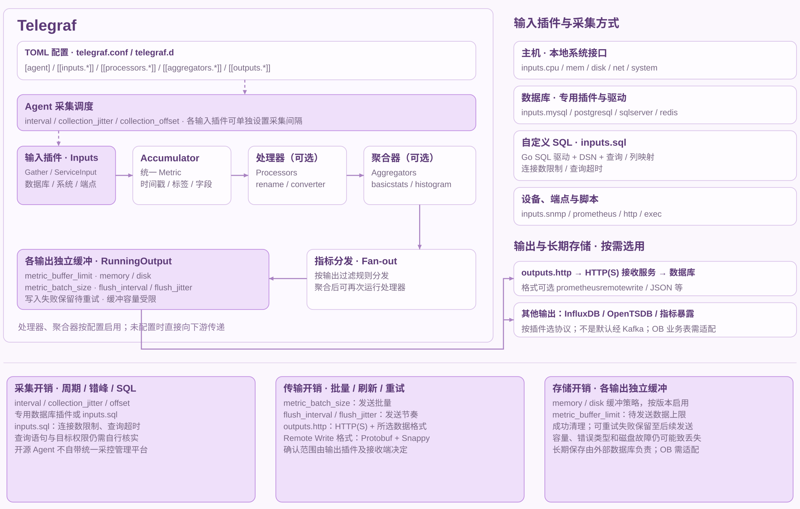
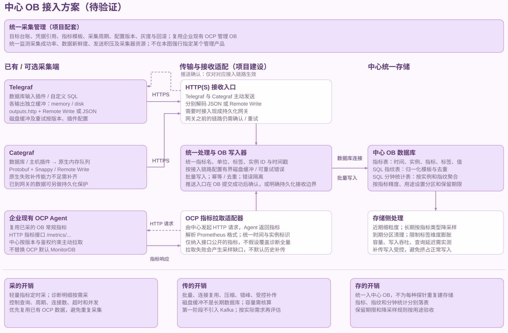

多种数据库长期并行，原厂工具各自能看清一套库，但从全局看，实例归属、指标口径、告警和变更分散在不同系统。智控平台先要把这些信息串起来。某套库告警时，值班人员应该能在一个入口里看清它属于哪个业务、走哪条采集链路、异常发生前后有哪些变化、哪些处置需要审批。

## 平台整体需要做的事

| 建设内容 | 先做什么 | 做到什么程度 |
| --- | --- | --- |
| 统一纳管与自动化运维 | 在 CMDB 中建立数据库实例、主机、业务、网段和负责人的关系。优先接入现有监控、日志和原厂工具 | 一个实例能查到资产、指标、告警、巡检和操作记录。再接定时巡检、备份、批量任务和工单 |
| 智能诊断与 SQL 治理 | 先做告警归并、指标与变更关联、慢 SQL 定位，以及有出处的知识检索 | 从告警能追到证据和建议。SQL 审核、优化建议、基线预测与报告逐步接入 |
| 安全管控 | 接入统一认证、角色授权、审批与 ITSM。把采集读取身份和生产操作身份分开 | 保留影响面、执行前检查、回滚预案、审批、执行、结果验证和审计。高危操作由人工兜底 |

轮值末尾提到两个可以先做的场景。做容量评估时，平台能拉出同一实例过去一年的容量曲线，标出缺失区间并给出预测依据。应用报慢时，平台能对照告警时段的资源消耗、Top SQL 和变更记录，让 DBA 在一个页面核查哪里发生了变化。这两项可以先做演示，用实际排查能否少切几个系统来判断平台是否好用。

**企业知识库**直接影响诊断能不能用。轮值里提到，同一个系统可能有正式名称、简称和历史叫法，CMDB 变更后，知识里的关联也要跟着更新。建议以 CMDB 资产 ID 为准维护别名，知识条目关联资产和适用环境，避免把系统名称和拓扑再维护一份。公开手册、企业 SOP、历史工单、复盘和专家经验分别保留来源、负责人、版本与权限。邮件、群消息和 AI 生成的摘要先进入候选区，经脱敏、去重和 DBA 复核后再入正式库。问答返回依据，证据不足时给出待核实项。已生效 SOP 的修改走版本和审批。

**密码加密存储**落在采集配置和平台执行两处。轮值提到企业已有密码安全存取能力，先确认复用接口与授权方式。配置里只存凭据引用，运行时受控读取，支持按实例或业务域轮换和吊销。数据库采集账号按库型和采集项授最小只读权限。传输用 TLS，日志、错误回显、诊断材料和知识库入库前过滤凭据和敏感参数。

## 第一层 · 采集

先按**信号缺口**决定怎么取数。已覆盖的 OceanBase 主机与库内常规指标优先复用 OCP，日志沿用现有日志平台。有现成主机监控就先接，库内状态再由区域采集节点用只读账号远程查。缺本机 CPU、内存、磁盘或指定日志，才在确有需求的主机上部署轻量探针。轮值里提到生产主机的权限与实验环境不同，因此采集矩阵还要写清每种库在现有权限下可采什么、安装和升级由谁执行、远程方式能否降级兜底。对接口和权限暂时不明确的库型，先定义最小指标集，再做真机验证。

zCloud 的 Server–Proxy–Agent 架构和 Bethune X 6 的双模式说明，同一平台可以同时支持远程连库与本机采集。阿里云 DAS 的 DBGateway 提供独立采集机这一部署参照。佰晟智算披露华润集团以总部、区域、下属企业三级方式纳管 1,200 多个数据库实例，现场的账号权限、回传和后端仍需核实。Bethune X 的金杯电工案例说明制造企业可把主机指标、活动会话和慢查询放到同一视图，现场使用哪种采集模式没有披露。 [zCloud 架构](https://enmotech.com/technology/article/1694) · [阿里云 DBGateway](https://help.aliyun.com/zh/das/user-guide/dbgateway-overview/) · [BIC-IA 华润案例](https://www.dbaiops.com/cases/case-crc-group) · [Bethune X 6 双模式说明](https://enmotech.com/about/news/1532) · [Bethune X 金杯电工案例](https://enmotech.com/customer/case/1579)

补充案例各解决一个问题。光大银行／ShinData DMP 适合参考跨机房的异构纳管，中国银行 TiZabbix 适合参考监控历史数据的存储与查询，工商银行统一 IT 监控适合参考存量接入与采集频率分级。DBdoctor 保留为有探针和无探针的覆盖对照，爱可生云树 DMP 的现网协议及存储还需向厂商核实。 [光大银行升级公示](https://m.mpaypass.com.cn/news/202107/25114234.html) · [中行实践](https://www.idiks.com/case/user-case-bank-of-china/) · [工行实践](https://www.fcc.com.cn/art/jrxxh/76/12400.shtml) · [DBdoctor 无 Agent 说明](https://github.com/DBdoctor-DAS/DBdoctor/blob/main/articles/DbdoctorIntroducesAgentlessLightweightManagementSolution.md) · [农行采购结果](https://www.abchina.com.cn/cn/AboutABC/CG/Purchase/202403/t20240320_2402365.htm)

以 Telegraf 为例，首轮样例从数据库所在主机取数。主机侧通过系统接口读取 CPU、内存和磁盘，数据库侧用本机只读连接读取状态计数器与配置，必要时采 SQL 指纹的累计统计。采集端按周期采样并限并发，输出按配置缓冲和批量发送。MySQL 指纹是可选项，首轮需要单独测采集 SQL 对目标库的影响。 [Telegraf 配置](https://docs.influxdata.com/telegraf/v1/configuration/) · [MySQL 输入插件](https://github.com/influxdata/telegraf/tree/master/plugins/inputs/mysql)

**eBPF 与 OpenTelemetry**分开验证。eBPF 适合在 I/O、网络、进程等现有数据解释不了的场景补充证据，先测内核兼容、权限、采样开销与采集范围。OpenTelemetry Collector 适合统一接收、处理和导出指标、日志和链路数据，可在观测链路中按需接入。库内等待事件、SQL 计划和数据库专有状态仍需对应的库内接口或原厂能力。观测云 DataKit 可作为一体化接入的对照。 [eBPF](https://ebpf.io/what-is-ebpf/) · [OpenTelemetry Collector](https://opentelemetry.io/docs/collector/) · [观测云数据库采集](https://docs.guance.com/infrastructure/database-collect/)

## 第二层 · 传输

**首轮跑探针主动 HTTPS 直传。** 对照稿中的直发基线只保留最新一轮，发送持续失败、下一轮覆盖时会产生缺口。实际试点先测批量、复用连接、错峰、限速与重试，需要补传时再加有容量上限的缓存。记录采集时间、接收时间和批次标识，明确返回成功代表已持久化接收还是 OB 已提交。对某些区域可用就近代理汇聚，评估隔离网段的访问规则和本地缓存。

**Kafka 留作条件选项。** 当中心需要容忍更长停机、入库吞吐无法直接接住突发，或告警和存储需要各自消费同一条数据时，用同一批样本实测两条路线。中心消费者恢复后，可从已提交的消费位点继续读取已写入 Kafka 且仍在保留期内的数据。探针到 Kafka 的失败仍需本地策略，消费侧也要处理重复和积压。

**跨中心容灾先明确在哪一层切换。** 轮值讨论了两条候选路线。一条由各区接收组件就近写入，有故障时切换写入目标。另一条由采集侧和入口将流量改投备用中心。首轮先把各区配置、缓存和告警边界划清，再用跨区断网和中心故障演练对比切换时间、数据缺口和重复写入，决定切换职责落在哪一层。

市场已有多种路径。zCloud 公布 Agent 到 Proxy 的 gRPC，Proxy 和 Prometheus 通过 HTTP 对接。观测云 DataKit 走 HTTP(S) 上报到 DataWay，并支持配置本地磁盘缓冲。Flashcat 指标可走 Remote Write，日志方案可用 Kafka。乐维证券案例的 Zabbix Proxy 能作分区代理与本地缓存的参照。DOCC 大方案里出现 Kafka 的证据，不能用于断定其所有指标必经消息队列。 [zCloud 架构](https://enmotech.com/technology/article/1694) · [DataKit 上报与缓冲](https://docs.guance.com/en/datakit/datakit-conf/) · [夜莺架构](https://flashcat.cloud/docs/content/flashcat-monitor/nightingale-v8/prologue/architecture/) · [Flashcat 日志](https://flashcat.cloud/docs/content/flashcat/log-analyse/step/) · [乐维证券案例](https://www.lwops.cn/index.php/news/success/5294)

## 第三层 · 存储

**中心 OceanBase 作为首轮验证路线。** OCP 用 OceanBase MonitorDB 承载监控数据，并与管理元数据分开。zCloud 的公开架构用 Prometheus 存时序指标，观测云可用 GuanceDB，乐维证券案例的中心后端是 PostgreSQL。能纳管 OceanBase 与能把外部产品的指标写入任意 OceanBase 业务表是两项能力，后者需要验证适配。 [OCP 系统架构](https://www.oceanbase.com/docs/enterprise-oceanbase-ocp-cn-10000000000377734) · [OCP 容量规划](https://www.oceanbase.com/docs/enterprise-oceanbase-ocp-cn-10000000002099287) · [观测云 GuanceDB](https://docs.guance.com/deployment/infra-metric/)

| 数据 | 首轮怎么存 |
| --- | --- |
| 指标 | 以时间、实例、指标名、标签和值为基础，按时间分区，设定保留期和降采样规则 |
| SQL 指纹 | 用指纹归类 SQL，保存必要的归一化模板并去重，避免原文参数进入诊断库 |
| SQL 分钟统计 | 按实例、指纹和时间桶记录次数、累计耗时、扫描行数等增量。遇到重启、计数器回绕或缺样，单独标记 |

中心接收服务负责统一实例 ID、指标单位和时间。累计计数器由中心按相邻样本计算增量，重试的批次幂等写入。首轮重点测写入与查询同时发生时的表现，再测历史预灌、到期清理和断网后的补传峰值。平台元数据、历史监控指标、日志和知识文档分别确定权限与保留周期。全量 SQL 和整包原文不进入这三张表。

上图展示了多采集来源的候选路径。首轮先验证已有 OCP 指标复用、典型库型的探针直传，以及三张表的写入和查询。

## 第四层 · 探针管理

管理能力放进现有智控平台。首版做节点注册、心跳、版本、最后成功采集时间、分组模板、配置下发结果、灰度升级与回滚。DOCC 的 AgentManager、观测云 DCA、夜莺专业版和乐维 Perseus 可分别参考其安装升级、批量配置与状态回报。首次安装可沿用企业已经审批的批量部署工具，运行期由采控页面管理配置和版本。 [云智慧 DOCC](https://cloudwise.com/cn/page/product-docc.html) · [观测云 DCA](https://docs.guance.com/datakit/dca/) · [夜莺探针管理](https://flashcat.cloud/docs/content/flashcat-monitor/nightingale-v9/usage/infrastructure/server-list/) · [乐维 Perseus](https://www.lwops.cn/index.php/movement/enterprise/13500)

**失联先分清是谁没响应。** 资产在线、探针在线、采集任务成功、中心落库成功是四个状态。监控页同时展示最近心跳、最近样本时间和失败原因。先区分主机故障、采集器故障、跨区网络异常和中心积压，再派工或降级。

轮值讨论的**治管隔离**可以落成一条验收用例。停掉某个采集节点或诊断智能体，该节点应显示失联或采样缺口，其他节点、生产数据库和人工运维入口继续工作。采集、诊断与生产变更分身份和权限。异常节点暂停配置下发或自动处置，恢复时核对版本、数据新鲜度和积压，再逐步放开。

## 首轮需要验证什么

| 验证 | 怎么做 | 看什么 |
| --- | --- | --- |
| 真机采集 | 用少量代表性主机和数据库，按同一批采集项比较复用、远程和本机探针 | 指标覆盖，主机 CPU、内存和网络开销，目标库查询耗时，账号权限 |
| 千节点链路 | 用压测程序模拟不同节点、真实标签和频率，测试错峰及集中上报。假设每台 15 秒采 200 个点，千台平均约 1.33 万点每秒 | 接收成功率，端到端时延，突发写入，积压，历史查询。该速率是样例假设 |
| 故障与恢复 | 模拟断网、探针退出、中心重启、OB 写入变慢、配置发布失败 | 采集缺口可见性，丢点和重复，回放及恢复时间，节点隔离、灰度回滚 |
| 诊断实用性 | 日常监控用定时采集，诊断时按需用只读连接补查。回放真实故障请 DBA 对照处理 | 能否定位到正确实例和时间窗，能否追溯证据，临时补查的开销及操作审批是否可控 |

第一轮交付四样东西。**采集矩阵、从真机到中心的最短链路、一次带故障的压测报告、一张能判断采集是否正常的管理页。** 开始前和运维方约定目标库开销、可接受延迟与丢点、断网恢复时间和查询耗时，以结果决定是否扩展到区域代理、Kafka 或深度采集。
