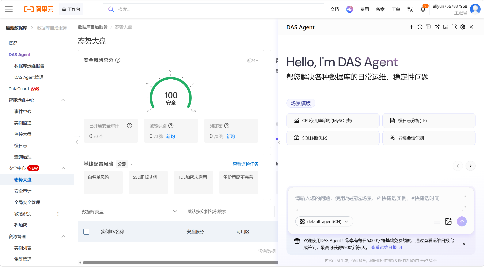

这篇笔记整理了我对数据库智能运维的初步调研思路。当前重点是理解产品功能、典型场景与企业需求，暂不展开具体技术实现。

希望通过竞品调研和实际场景分析，建立对智能运维的认识，再结合企业已经确定的需求，讨论如何把“智能”真正融入数据库运维 Agent。

## 一、先了解什么

### 产品功能与运维知识

调研可以先从以下几个方面入手：

1. **产品功能**：现有产品有哪些功能？如何在既定功能中引入智能化能力？
2. **运维知识**：有哪些常见故障类型、处理方法与优化方法？诊断需要哪些数据和知识输入？
3. **技术实现**：暂不作为当前重点，先明确业务场景和能力目标。

### 重点场景：智能诊断与性能优化

| 场景 | 需要了解的基础内容 | 重点关注的智能化能力 |
| --- | --- | --- |
| 智能诊断 | 传统规则与阈值检测 | 异常识别、根因推理和证据分析 |
| 性能优化 | 慢 SQL、索引和参数优化 | 智能分析瓶颈、生成优化建议、验证优化效果 |

## 二、调研需要回答的四个核心问题

1. **智能运维能做什么？** 在数据库故障诊断、性能优化等场景中，有哪些值得参考的功能？
2. **“智能”体现在哪里？** 相比传统监控、告警和人工排查，智能运维能减少哪些人工判断和操作？
3. **其他产品怎么做？** 以阿里云 DAS 等产品为调研对象，了解它们如何发现异常、分析原因、给出建议和处理问题。
4. **我们可以借鉴什么？** 哪些产品能力符合企业现有需求，哪些还需要和企业进一步沟通、讨论？

这里的问题是后续调研的提纲，并不代表已经完成对相关产品能力的验证。

## 三、六个调研方向

| 调研方向 | 需要了解的具体内容 | 希望与企业讨论的问题 |
| --- | --- | --- |
| 智能异常发现 | 自动识别性能异常、发现潜在风险、提前预警 | 系统需要主动发现问题，还是由用户发起诊断？ |
| 智能故障诊断 | 综合分析指标、SQL 和日志，定位可能的故障原因 | 需要诊断到什么程度？识别实例异常，还是定位具体根因？ |
| 智能性能优化 | 慢 SQL 分析、索引建议、性能瓶颈识别 | 优化功能只提供建议，还是需要进一步执行？ |
| Agent 智能交互 | 用户通过自然语言描述问题，由系统自主组织排查 | 是否希望通过对话完成诊断和运维操作？ |
| 智能处理建议 | 根据诊断结果生成处理步骤和风险提示 | 是否需要生成可以直接操作的解决方案？ |
| 运维经验沉淀 | 保存故障案例、关联历史问题、复用解决经验 | 企业是否已有运维经验、故障案例和处理手册？ |

这六个方向用于调研其他产品、组织沟通问题，不是重新规划企业的产品功能。

对尚不了解的部分，我希望带着问题主动讨论，在交流中逐步补齐认识。

## 四、与企业具体讨论哪些问题

### 1. 智能诊断

- 企业希望覆盖哪些具体场景？例如 CPU 使用率高、SQL 变慢、连接异常、锁等待等。
- 希望系统自动发现问题，还是由用户发起诊断？
- 诊断结果需要给出异常现象、可能原因，还是进一步定位根因？

### 2. 性能优化

- 希望覆盖 SQL 优化、索引优化、参数优化中的哪些内容？
- 系统给出建议是否足够？是否存在需要自动执行的场景？
- 优化前后是否需要提供效果对比？

### 3. Agent 智能化

- 希望 Agent 主要承担智能问答、辅助分析、自动排查，还是受控执行？
- 现有监控、诊断功能如何与 Agent 配合？
- 哪些操作需要人工确认？

### 4. 运维知识

- 企业能否提供典型故障案例、处理经验和诊断规则？
- 哪些问题最常见，哪些人工排查过程最耗时？
- 哪些场景适合先作为智能运维的验证案例？

## 五、调研前准备哪些材料

1. **智能运维的概念与价值**：相比传统运维，有什么不同？
2. **典型运维场景**：重点关注智能诊断与性能优化。
3. **产品功能与案例分析**：其他产品如何发现、诊断、优化和处理问题？
4. **Agent 与运维的结合方式**：Agent 在不同业务中能承担什么角色？先讨论能做什么，不展开技术路线。
5. **可借鉴的产品思路**：哪些能力和交互方式值得借鉴？
6. **与企业探讨的问题**：明确诊断范围、智能化深度、输出结果与人工参与边界。

## 六、用同一套问题比较不同方案

围绕一个具体场景，可以从四个角度展开比较：

| 比较角度 | 需要回答的问题 |
| --- | --- |
| 传统方式 | 过去如何发现问题、分析原因并进行处理？ |
| 其他产品 | 同类产品采用了什么功能与交互方式？ |
| Agent 能力 | 哪些判断、分析或操作可以由 Agent 辅助完成？ |
| 企业期望 | 企业希望系统做到什么程度，人工参与边界在哪里？ |

当前阶段的重点，是先把场景、问题和期望结果问清楚，再讨论如何实现。

## 参考产品阿里云DAS

