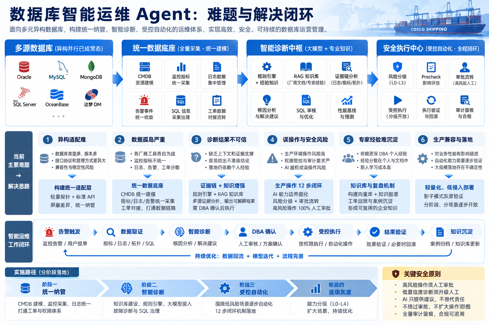

多种数据库共存时，运维的难点不仅是缺少自动化，更是**资源、数据和工具分散，难以形成统一的管理视角**。Oracle、OceanBase、达梦、SQL Server 等数据库在接口、指标和管理方式上各有差异；如果接入与数据口径没有统一，后续的智能诊断也难以获得完整、可信的上下文。

因此，当前应优先做好统一纳管：先解决“有哪些资源、数据从哪里来、如何关联、谁能访问”，再逐步引入智能诊断和受控自动化。

## 一、统一纳管要管什么

统一纳管不只是把各类数据库显示在一个页面中，而是建立统一的资源模型和数据链路。

| 纳管对象 | 当前问题 | 建设重点 |
| --- | --- | --- |
| 数据库与主机资源 | 类型、版本和管理方式不同，资源关系不清晰 | 通过 CMDB 统一建模，关联主机、实例及业务关系 |
| 采集工具与接入接口 | 原厂工具相互独立，接口协议存在差异 | 建设适配层，以轻量采集和标准接口屏蔽差异 |
| 指标、日志与 SQL 信息 | 数据分散、指标口径不一，难以联合分析 | 统一采集与指标语义，按资源和时间关联数据 |
| 告警、工单与处置记录 | 告警与实际处理过程脱节，经验难以复用 | 汇聚事件并对接工单，保留取证、处置与复盘记录 |
| 权限与操作审计 | 不同工具权限分散，生产操作难以统一约束 | 统一身份与授权边界，记录操作对象、执行过程和结果 |

### 采集 Agent 也需要集中管理

如果采用“一台服务器部署一个采集 Agent”的方式，管理重点就不能只停留在数据库本身。**采集 Agent 是接入链路的一部分，也应纳入统一管理。**

作为落地设计，建议重点明确：

- **身份与关联**：Agent 部署在哪台主机、负责哪些实例，采集数据如何对应到资源模型。
- **配置与状态**：集中管理采集任务、频率和版本，掌握在线状态、采集失败及数据缺失情况。
- **权限与影响**：控制采集账号权限和采集开销，避免采集活动影响生产稳定。

这部分是对统一纳管的实施建议，具体部署粒度、采集频率和管理方式仍需结合现有环境验证。

## 二、统一纳管如何支撑运维闭环

整体可以按“多源数据库 → 统一数据底座 → 智能诊断 → 安全执行”的顺序建设。统一纳管首先打通资源与数据，后续环节才有可靠的输入。

*数据库智能运维闭环全景图。当前重点是左侧的异构接入与统一数据底座，诊断和执行能力在此基础上逐步扩展。*

一条可验证的链路应能够回答：**哪个资源发生了异常、对应哪些指标和日志、触发了什么告警、由谁处理、结果如何。**

在这一基础上，智能诊断可以结合规则、历史案例、RAG 知识库和大模型提出根因与处置建议，但结论应关联可核验的证据。生产执行则由确定性工作流完成权限校验、风险评估、审批、执行验证与必要的回滚；高风险操作由人工确认，不能仅依靠提示词限制 Agent。

## 三、建议的落地顺序

1. **先统一纳管**：完成资源建模、异构适配、轻量采集和数据汇聚，打通告警、工单与权限体系。
2. **再验证智能诊断**：从慢 SQL 或数据库告警定位切入，检查证据是否完整、诊断是否有用。
3. **逐步开放自动化**：优先低风险场景，以审批、验证、回滚和审计构成受控闭环。
4. **持续沉淀知识**：将经过 DBA 确认的诊断与处置结果整理为案例，反哺后续分析。

近期更值得优先验证的，是一条从资源接入、异常取证到人工确认和结果归档的完整链路。统一纳管的价值，最终体现在数据能否关联、问题能否追溯，以及后续能力能否在同一套权限与安全边界内运行。
